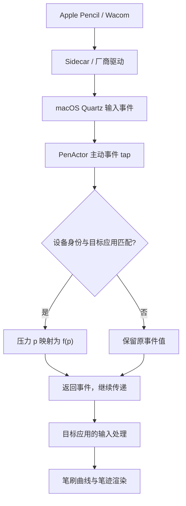

# PenActor 压力重映射原理

本文保留 PenActor 0.2.0 的静态压力映射原理，核心实现提交 `b9d2cba`。0.3.0 新增入锋和需要缓存重发的出锋路径，当前行为见 [入锋与出锋说明](stroke-taper.md)。说明日期：2026-10-21。

PenActor 在 macOS 把输入事件送往应用的过程中，通过 **Quartz 主动事件 tap** 取得事件，对匹配设备和应用的压力字段应用曲线，然后返回修改后的原事件。因此，沿这条输入路径接收事件的绘画应用，可以读到修改后的压力。

2026-10-21，用户重新运行本版本后反馈「确实生效了」。这为当前测试环境中的实际输入链路提供了初步验证；本次反馈没有逐项记录目标应用、笔刷、曲线和系统版本，不能据此认定 Photoshop、CSP 及所有设备组合已全部通过验收。

## 1. 修改发生在哪里

下面是理解本项目的简化链路，不是对 macOS 全部内部处理步骤的描述：



macOS 提供 AppKit `NSEvent` 与 Quartz `CGEvent` 等公共输入事件 API。Sidecar 和数位板驱动可以通过数位笔事件提供压力；这使通用的事件层处理成为可能，但不能推导出所有应用、驱动都只通过同一条路径读取输入。

本项目有两条独立路径：

| 路径 | 本项目的用途 | 能否改变其他应用收到的压力 |
| --- | --- | --- |
| AppKit 本地 / 全局 `NSEvent` monitor | 面板读数、设备观察、趋势、事件列表 | 全局 monitor 只观察；本地 monitor 在本项目中原样返回事件 |
| Quartz 主动 `CGEvent` tap | 同步匹配和压力修改、修改前后诊断 | 可以修改经过该 tap、继续传向应用的事件 |

因此，仅仅把调试面板里显示的压力乘以一个系数，不会改变 Photoshop 的输入。实际生效的是新增的 Quartz 路径。

## 2. 主动事件 tap 如何工作

`PressureRemappingEngine` 使用以下参数创建 tap：

```swift
CGEvent.tapCreate(
    tap: .cgAnnotatedSessionEventTap,
    place: .tailAppendEventTap,
    options: .defaultTap,
    eventsOfInterest: mask,
    callback: callback,
    userInfo: context
)
```

- `cgAnnotatedSessionEventTap`：选择带应用路由注释的会话事件阶段；本项目在这里读取事件的目标进程标识。
- `tailAppendEventTap`：追加到该位置的事件 tap 列表尾部。它不保证 PenActor 是全系统永远最后一个处理者。
- `defaultTap`：允许回调修改事件；单纯观察的 tap 无法完成这个功能。
- `mask`：只订阅需要的数位笔及相关鼠标事件。

回调处理完成后返回 `Unmanaged.passUnretained(event)`。代码直接修改传入的事件，没有取消后另造一条输入再发送，也没有调用 `CGEvent.post`。坐标、倾斜、按钮、时间戳等字段沿用原值；本版不增加插值采样或排队回放。

这与 Mos 的思路相通：在事件进入应用前做条件处理。但笔压需要在每个输入事件上及时算出结果，当前实现没有采用滚动动画那样的定时平滑输出。

## 3. 怎样只修改指定设备

点采样中的 `deviceID` 是会话标识，重连后可能改变。配置不直接绑定这个临时编号。

引擎在自己的事件流中读取 **proximity（进入 / 离开感应范围）** 元数据，建立以下关联：

```text
当前事件的 deviceID
    → 本 tap 收到的 proximity 元数据
    → PenIdentity 稳定匹配键
    → 该身份已启用的配置
```

稳定身份算法与调试面板共用，优先级为：有效 Unique ID → 有效序列号 → 厂商 / 型号 / 工具类型归组；无法确定时保留临时会话。

目前 Sidecar 报告的 Pencil 缺少有效 Unique ID 和序列号，因此使用 `v1:model:5ac:129a:0:pen` 这样的型号键。它可以跨重连复用配置，但不能区分多支同型号实体笔。Wacom 若提供有效唯一标识，则可匹配到具体工具；笔尖与橡皮擦也可能是不同身份。

事件回调必须立即决定是否修改，不能等待主线程的设备列表刷新。因此，引擎独立维护会话关联，不从面板的当前选择推断输入设备。**新启动 tap 后需要再收到 proximity**；这就是启用后让笔移开再靠近的原因。

只有稳定身份对应的配置被启用，才可能修改压力。未启用配置的 Wacom、未知设备和普通鼠标保留原值；切换面板中查看的设备不会改变其他设备的启用状态。

## 4. 怎样只作用于 Photoshop 或 CSP

应用选择保存的是 **bundle ID**。例如本机 Photoshop 为 `com.adobe.Photoshop`。

回调读取 `CGEventField.eventTargetUnixProcessID`，再查询预先维护的 PID → bundle ID 表，判断是否命中配置的目标应用。进程表由主线程在启用配置和应用启动 / 退出等时机更新，回调中不进行同步应用查询。

这里使用事件的目标进程，而不是“当前前台应用”。调试日志中的 `foregroundApp` 仍只是观察上下文，不能替代目标 PID。目标 PID 缺失或不能解析时，事件透传，不用前台应用猜测。

## 5. 压力曲线如何计算

曲线把归一化压力 `p ∈ [0,1]` 变换为 `f(p) ∈ [0,1]`。增强预设经过以下控制点：

| 输入压力 | 理论输出压力 |
| --- | --- |
| 0% | 0% |
| 25% | 50% |
| 50% | 80% |
| 100% | 100% |

输入 50% 被提升至约 80%，应用若使用该压力控制笔刷尺寸、不透明度等参数，就能在较轻的物理力度下得到更强的笔刷响应。它改变的是输入数值与笔刷响应的关系，没有改变 Pencil 传感器的物理特性或校准。

实现使用单调三次 Hermite 插值：内点切线采用 PCHIP 风格的加权调和平均，端点切线采用相邻割线斜率，区间结果限制在相邻控制点的输出范围内。控制点 X 递增、Y 不下降，允许低压平段和提前满压平台，避免曲线过冲和反向响应。

端点固定为 `(0,0)`、`(1,1)`。有效零压力映射后仍为零；线性配置跳过相同值写入，避免一次无意义的写回再次量化压力。

### 为什么处理两个压力字段

数位笔数据既可能出现在独立的 `.tabletPointer` 事件，也可能出现在带 tablet subtype 的鼠标按下、拖动、抬起事件中。当前覆盖：

| 字段 | 本项目的处理 |
| --- | --- |
| `tabletEventPointPressure` | 独立数位笔事件及带 tablet point subtype 的有效鼠标事件中，按曲线映射 |
| `mouseEventPressure` | 带 tablet point subtype 的有效鼠标按下 / 拖动 / 抬起事件中，另行映射 |

两者可能有不同值和存储精度，因此分别读取、分别计算，不把一个字段的输入简单复制给另一个。普通鼠标、非笔 subtype、proximity 及 `mouseMoved` 不执行压力改写。

系统字段会量化写入值，理论 `0.8` 不保证读回后恰好是 `0.800000…`。日志在写回后重新读取，记录实际输出，不能通过它反推出硬件真实压力级数。

## 6. 为什么保存后等到下一笔生效

笔画开始时，引擎锁定这笔使用的配置副本和目标 PID。过程中编辑曲线或切换同设备配置，不会让正在绘制的一条线突然切换压力响应；下一笔才使用新配置。

未命中配置的笔画也会锁定透传决定。禁用配置立即恢复透传；若在同一笔中重新启用，仍保持透传至抬笔。零压力、抬起和离开感应范围等事件用于结束对应状态；没有 tablet subtype 的普通鼠标释放也会清理遗留笔画状态。

独立事件先出现但没有可解析目标时，不会阻止后续带有效目标的鼠标按下事件建立配置关联。不同事件形式并不被假定为总有相同目标 PID，也不人为一一配对。

## 7. 线程、权限与停止行为

主动 tap 安装在专用线程的 RunLoop 中。回调内只读取字段、匹配内存状态、计算压力、修改原事件和更新有界诊断；不执行 UI、磁盘读写或同步进程查询。

配置、应用对照表和诊断快照由短临界区的 `NSLock` 保护。界面最多以 60 Hz 发布变化，事件压力修改仍在各次 tap 回调内同步完成，不等待界面刷新。诊断最多 500 条，会话和笔画状态最多各 128 个。

应用展示输入监控与辅助功能两种独立权限状态；启用主动映射前检查辅助功能权限。创建 tap 失败、系统因超时 / 用户输入停用 tap，或事件线程结束时，程序停止映射并保留原因，不无限自动重启。

`⌘⇧R`、暂停全部映射、停止监听和退出应用均会停止修改。线程退出时禁用并销毁 tap、移除 RunLoop source；启动代号防止上一次线程迟到的回调修改新一轮状态。配置写入 `~/Library/Application Support/PenActor/profiles.json`，应用重启后保留配置，但不自动启用。

## 8. 日志为什么分成两条事件流

`schemaVersion: 2` 的导出同时包含：

- `events`：AppKit monitor 观察到的事件。启用映射后，它可能已经是修改后的压力。
- `mapping.diagnostics`：主动 tap 当场记录的设备身份、目标 PID / bundle ID、配置 UUID、修改前后压力及透传原因。
- `profiles` 与 `mapping.activeProfiles`：已保存配置及导出时的启用配置快照。

诊断中的 `inputPressure / outputPressure` 对应主要压力字段：独立数位笔事件使用 tablet 压力，鼠标形式使用 mouse 压力。`tabletInputPressure / tabletOutputPressure` 额外保留 tablet 字段的对照；独立数位笔事件中它们与主要字段相同。

“修改前压力”指到达本 tap 时的系统事件值，仍可能已经过 Sidecar、厂商驱动或更早的事件处理。它不是未经处理的硬件原始采样。

`modifiedEventCount` 统计至少一个压力字段实际发生变化的事件，不是应用确认接收的数量；线性配置即使命中也可能计数为零。两条事件流分别保留最近 500 条，不通过记录位置或数量强行配对。正在绘制时锁定的旧曲线也可能与刚保存的最新配置不同，判断实际输出应以诊断值为准。

## 9. 这次生效能说明什么

用户反馈表明：当前测试中，PenActor 修改事件压力的方法确实影响了实际绘画响应。它支持继续沿 Quartz 事件层推进设备配置，而无需先开发新的数位板驱动或修改绘画应用。

绘画最终效果仍可近似理解为：

```text
物理力度 → 设备 / 驱动 / Sidecar 处理 → PenActor 曲线 → 应用输入处理与笔刷曲线 → 笔迹
```

即使 PenActor 输出相同，PS 与 CSP 的笔刷曲线、最小尺寸、起笔设置等不同，也可能产生不同效果。某些应用或厂商 SDK 可能从其他路径读取输入；当前成功不能覆盖所有应用、版本与工具。

**静态曲线也不等于起笔修正。** 此前观察到的 `0.0784 → 0.0118 → 再上升`，经过单调曲线通常仍保留“先高后低”的关系，平台可以压缩差异，但没有识别它是不是异常起笔。后续修正需要另行分析落笔后的时间、移动距离与压力变化，并保护点画和有意重压起笔；当前版本没有实现这一阶段判断。

## 10. 代码入口与验证范围

| 文件 | 职责 |
| --- | --- |
| [PressureRemappingEngine.swift](../PenActor/PressureRemappingEngine.swift) | 主动 tap 生命周期、Quartz 解析、设备和应用匹配、笔画锁定、诊断 |
| [PressureProfiles.swift](../PenActor/PressureProfiles.swift) | 曲线插值、配置验证、JSON 持久化 |
| [PenModels.swift](../PenActor/PenModels.swift) | 共用稳定身份解析 |
| [PenMonitor.swift](../PenActor/PenMonitor.swift) | 权限、启停、应用进程表、配置和界面状态协调 |
| [PressureMappingPanel.swift](../PenActor/PressureMappingPanel.swift) | 设备配置、应用选择和曲线编辑 |
| [PenLogExport.swift](../PenActor/PenLogExport.swift) | schema 2 导出 |
| [PressureMappingTests.swift](../PenActorTests/PressureMappingTests.swift) | 曲线、字段保持、设备 / 应用筛选、重连、锁定、持久化与故障夹具 |

0.2.0 在 arm64 上通过 69 项自动化测试，Release 完成 arm64 / x86_64 构建。自动化测试不创建真实主动 tap，不向系统注入测试事件；失败 / 停用通过注入工厂验证。用户本次反馈单独构成初步实机证据，完整兼容性矩阵仍需逐项记录。

## 苹果官方参考

- [Quartz 事件 tap 回调与事件修改语义](https://developer.apple.com/documentation/coregraphics/cgeventtapcallback)
- [Annotated session tap 位置](https://developer.apple.com/documentation/coregraphics/cgeventtaplocation/cgannotatedsessioneventtap)
- [事件目标进程 ID](https://developer.apple.com/documentation/coregraphics/cgeventfield/eventtargetunixprocessid)
- [数位笔压力字段](https://developer.apple.com/documentation/coregraphics/cgeventfield/tableteventpointpressure)
- [鼠标压力字段](https://developer.apple.com/documentation/coregraphics/cgeventfield/mouseeventpressure)
- [AppKit 本地与全局事件监听](https://developer.apple.com/library/archive/documentation/Cocoa/Conceptual/EventOverview/MonitoringEvents/MonitoringEvents.html)
- [Sidecar 与 Apple Pencil，WWDC19](https://developer.apple.com/videos/play/wwdc2019/210/)

本实现的字段和回调约定也对照了本机 Xcode 27.1 SDK 中的 `CoreGraphics/CGEvent.h` 与 `CoreGraphics/CGEventTypes.h`。上述线程、匹配、曲线及故障策略是 PenActor 的实现选择，不是苹果对所有绘画应用行为的保证。
